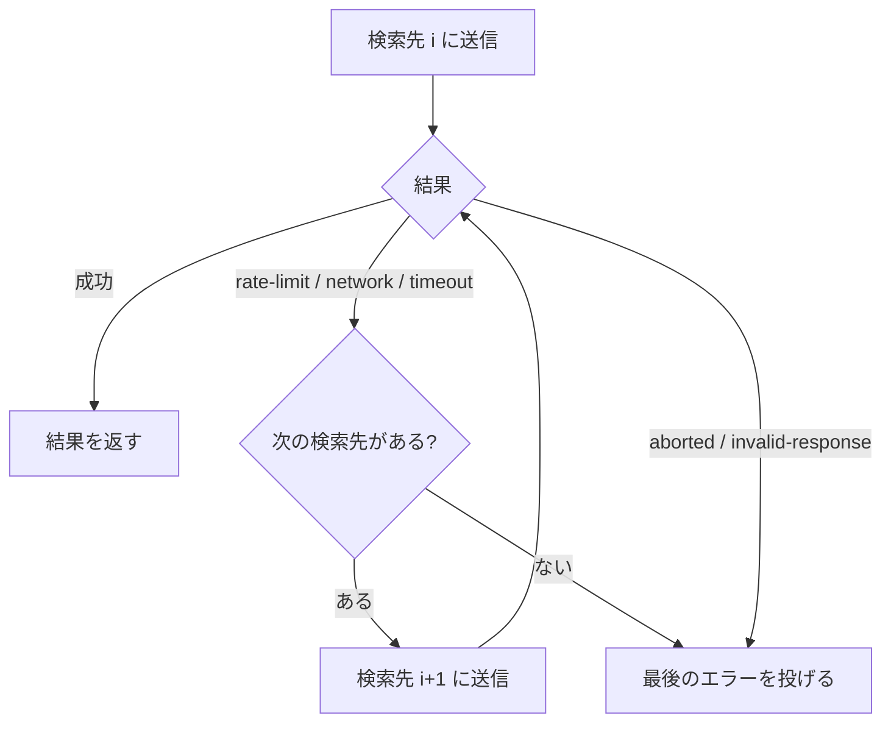

# 設計：駐車場検索で結果が得られない不具合の修正

本書は `requirements.md` の内容を実装するための方針を定義する。

## 1. 原因のまとめ

| # | 原因 | 種類 | 対応 |
|---|---|---|---|
| 1 | overpass-api.de の混雑（504・応答なし） | 外部の要因 | 2.2、2.3 で影響を小さくする |
| 2 | アプリのタイムアウト（15 秒）が、クエリで指定するサーバーの処理時間の上限（25 秒）より短い | アプリの不具合 | 2.1 で修正する |
| 3 | 検索先が 1 か所だけで、混雑すると検索が使えない | 設計上の弱点 | 2.2 で複数の検索先に対応する |
| 4 | 502・503 を「混雑」ではなく通信の失敗として扱っている | 表示の問題 | 2.3 で修正する |

### 1.1 ブラウザでの確認を受けた設計の変更（2026-11-26）

タスク 4-2 で、overpass-api.de が**応答をまったく返さずにタイムアウトする**失敗が多いことが分かった（3 回中 2 回。502 は 1 回）。クエリで `[timeout:20]` を指定しても応答が返らないため、サーバーは処理を始める前の段階で止まっていると考えられる。

この結果を受けて、次の 4 点を変更する（すべてユーザー承認済み。D はあとから追加した）。

| # | 変更 | 該当する節 |
|---|---|---|
| A | タイムアウトしたときも、次の検索先を試す。1 か所あたりの待ち時間を 25 秒から 15 秒に短くし、合計の待ち時間を抑える | 2.1、2.2 |
| B | タイムアウトしたときの文言を、通信の失敗と分ける | 2.5 |
| C | 既定の検索先に、ブラウザから使えることを確かめた `maps.mail.ru` を加え、最初に試す（ユーザーの提案） | 2.2 |
| D | NextGIS の Overpass API（API キーが必要）を、環境変数で既定の 2 件の前に加える | 2.2 |

## 2. 実装アプローチ

### 2.1 タイムアウトの整合（原因 2）

サーバー側の上限とアプリ側の上限を、1 つの定数から決める。

```ts
// overpassParkingProvider.ts
/** サーバーに許す処理時間の上限（秒）。クエリの [timeout:N] に使う */
export const QUERY_TIMEOUT_S = 10;
/** 応答の転送にかかる時間の余裕 */
const RESPONSE_MARGIN_MS = 5_000;
export const TIMEOUT_MS = QUERY_TIMEOUT_S * 1000 + RESPONSE_MARGIN_MS; // 15 秒（検索先 1 か所あたり）
```

- サーバーに許す処理時間を 25 秒から 10 秒に短くする（1.1 節の変更 A。当初の設計では 20 秒）
  - 半径 5km 以内の駐車場の検索は、混雑していなければ数秒で終わる。10 秒を超えるのは、ほとんどがサーバーの処理待ちのとき
  - タイムアウトしたときも次の検索先を試すため、1 か所あたりの待ち時間を短くする。最大の待ち時間は「15 秒 × 検索先の数」（2 か所なら 30 秒、3 か所なら 45 秒）
- アプリのタイムアウトは「サーバーの上限＋5 秒」とする。サーバーが上限ぎりぎりで返した結果も受け取れるようにするため
- 単体テストで `TIMEOUT_MS > QUERY_TIMEOUT_S * 1000` を確かめ、今後どちらか片方だけを変えたときに気付けるようにする

### 2.2 複数の検索先への対応（原因 3）

#### 設定

環境変数 `VITE_OVERPASS_URL` に、カンマ区切りで複数の URL を指定できるようにする。

```
VITE_OVERPASS_URL=https://overpass-api.de/api/interpreter,https://<代替の検索先>/api/interpreter
```

- `AppConfig.overpassUrl: string` を `overpassUrls: string[]` に変える
- 1 件ずつ既存の `parseHttpsUrl` で検証し、不正な URL は捨てる。1 件も残らなければ既定値を使う
- 重複は取り除く。件数は最大 3 件までとする（混雑時に何か所も試して、利用者を長く待たせないため）
- 1 件だけを指定する従来の書き方も、そのまま使える

#### 既定の検索先

- 既定値は次の 2 件とし、この順に試す

  | 順 | 検索先 | 備考 |
  |---|---|---|
  | 1 | `https://maps.mail.ru/osm/tools/overpass/api/interpreter` | VK（Mail.ru）が運営する公開インスタンス。2026-11-26 にユーザーがブラウザから使えることを確かめた（タスク 4-3） |
  | 2 | `https://overpass-api.de/api/interpreter` | Overpass API の公式の公開インスタンス |

- `maps.mail.ru` を先にする理由
  - overpass-api.de は、2026-11-26 の確認で 3 回中 2 回が応答なしだった。先に試すと、混雑している間は検索のたびに 15 秒待ってから切り替わる
  - 混雑している公式のインスタンスに、さらに負荷をかけずに済む
  - 順番は `VITE_OVERPASS_URL` で変えられる。公式のインスタンスが安定したら、コードを変えずに戻せる
- ブラウザで確かめた候補のうち、`overpass.private.coffee`・`overpass.kumi.systems` は使えなかった
- NextGIS の Overpass API（`https://overpass.nextgis.com/<APIキー>/api/interpreter`）も、2026-11-26 にユーザーがブラウザから使えることを確かめた（1.1 節の変更 D）
  - 無料だが、API キーが URL に含まれる。キーをリポジトリに書かないため、既定値には入れない
  - 環境変数で、既定の 2 件の前に加える。順番は NextGIS → maps.mail.ru → overpass-api.de（最大 3 件に収まる）

    | 環境 | 設定する場所 |
    |---|---|
    | ローカル | `.env`（git の管理対象外）の `VITE_OVERPASS_URL` |
    | GitHub Pages | リポジトリの Variables の `VITE_OVERPASS_URL`（`deploy.yml` が参照している） |

  - 静的サイトのため、ビルドしたファイルにキーが含まれ、利用者から見える。無料のキーで課金は発生しないため、許容する
  - コードの変更は不要。`VITE_OVERPASS_URL` の解析（2.2 節）と CSP（2.4 節）は、指定した検索先をそのまま扱える
- 通常の検索は、すべて VK（Mail.ru）が運営するインスタンスが受ける（検索した地点の座標が送られる）。利用規約は、公開前にユーザーが確かめる（tasklist 4-4）
- 既定値は `.env` や GitHub の Variables の `VITE_OVERPASS_URL` で上書きできる

#### 切り替えの動き

`OverpassParkingProvider` が URL の配列を受け取り、先頭から順に試す。



| 失敗の種類 | 次の検索先を試すか | 理由 |
|---|---|---|
| `rate-limit`（429・502・503・504） | 試す | 混雑はその検索先だけの問題のことが多く、すぐに失敗するので待ち時間も短い |
| `network`（406 などの HTTP エラー、接続の失敗） | 試す | その検索先だけが拒否している、または停止している可能性がある |
| `timeout` | 試す（1.1 節の変更 A。当初の設計では試さなかった） | 実際の失敗の多くは、サーバーが応答を返さないタイムアウトだった。1 か所あたりを 15 秒に短くして待ち時間を抑える |
| `aborted` | 試さない | 利用者による中断（新しい検索を始めたなど） |
| `invalid-response` | 試さない | 応答の形式の問題で、検索先を変えても直る見込みが低い |

- 自動のリトライは、検索先を順に 1 回ずつ試すだけにする。同じ検索先への再送はしない（利用規約と相手サーバーへの負荷を考慮する）
- 呼び出し間隔の制御（`RequestThrottle`）は、これまでどおりサービス層で検索 1 回ごとにかける。検索先が異なれば相手サーバーも異なるため、検索先を切り替えるときに 1 秒待つ必要はない
- 検索先を切り替えるときは、呼び出し元の `signal` を引き継ぐ。中断されたら、それ以上は試さない

### 2.3 混雑時の HTTP ステータスの扱い（原因 4）

`fetchJson` で `rate-limit` として扱うステータスに、502（Bad Gateway）と 503（Service Unavailable）を加える。

| ステータス | 変更前 | 変更後 |
|---|---|---|
| 429、504 | `rate-limit` | `rate-limit`（変更なし） |
| 502、503 | `network` | `rate-limit` |
| 406 などそれ以外の 4xx・5xx | `network` | `network`（変更なし） |

- 画面には「サーバーが混雑しています。少し待ってから再試行してください」が表示されるようになる（`searchErrorMessage`）
- `fetchJson` は Nominatim と共通の処理。Nominatim でも 502・503 は混雑を表すため、同じ扱いで問題ない

### 2.4 CSP

`vite.config.ts` の `contentSecurityPolicy` で、`connect-src` に `VITE_OVERPASS_URL` の**すべての**検索先のオリジンを含める。これを忘れると、本番環境でだけ代替の検索先への通信が CSP で遮断される。

既定の検索先（`DEFAULT_OVERPASS_URL`）を 2 件にするため、`vite.config.ts` と `src/config.ts` の既定値は、どちらもカンマ区切りの文字列として持つ。

### 2.5 タイムアウトしたときの文言（1.1 節の変更 B）

`src/components/messages.ts` に文言を追加し、`searchErrorMessage` で `timeout` を分ける。

| 失敗の種類 | 文言 |
|---|---|
| `rate-limit` | サーバーが混雑しています。少し待ってから再試行してください（変更なし） |
| `timeout` | **サーバーから応答がありませんでした。混雑している可能性があります。少し待ってから再試行してください**（追加） |
| それ以外 | 駐車場情報を取得できませんでした（変更なし） |

- 再試行ボタンは、これまでどおりすべての失敗で表示する
- 地名検索（`geocodeFailed`）の文言は変えない

## 3. 変更するコンポーネント

| ファイル | 変更内容 |
|---|---|
| `src/providers/osm/overpassParkingProvider.ts` | タイムアウトの定数（2.1）、複数の検索先の順番での試行（2.2） |
| `src/providers/fetchJson.ts` | 502・503 を `rate-limit` として扱う（2.3） |
| `src/config.ts` | `overpassUrl` を `overpassUrls: string[]` に変え、カンマ区切りを解析する。既定値を 2 件にする（2.2） |
| `src/providers/index.ts` | `config.overpassUrls` を渡す |
| `vite.config.ts` | CSP にすべての検索先のオリジンを含める。既定値を 2 件にする（2.4） |
| `src/components/messages.ts` | タイムアウトの文言を追加し、`searchErrorMessage` で分ける（2.5） |
| `.env.example` | 複数指定の書き方の説明と、既定の 2 件を記載する |

フック、サービス層は変更しない。画面のコンポーネントは、文言の関数（`searchErrorMessage`）を通じて表示が変わるだけで、コードは変更しない。

## 4. データ構造の変更

```ts
// 変更前
type AppConfig = { overpassUrl: string; /* ... */ };
// 変更後
type AppConfig = { overpassUrls: string[]; /* 1 件以上。先頭から順に試す */ };
```

保存しているデータ（お気に入り・設定）には影響しない。

## 5. テスト

| 対象 | 確かめる内容 |
|---|---|
| `overpassParkingProvider.test.ts` | `TIMEOUT_MS > QUERY_TIMEOUT_S * 1000`。クエリに `[timeout:10]` が入る。1 か所目が 504・502・406・タイムアウトのときは 2 か所目の結果を返す。aborted・invalid-response のときは 2 か所目を試さない。全部失敗したときは最後のエラーを投げる。中断されたら残りを試さない |
| `fetchJson`（`overpassParkingProvider.test.ts` の既存のステータスのテストを拡張） | 502・503 が `rate-limit` になる。406 は `network` のまま |
| `config.test.ts` | カンマ区切りの解析、前後の空白の除去、不正な URL の除外、重複の除去、最大 3 件、全部不正なときは既定値（2 件） |
| `messages`（`ParkingList.test.tsx` などの既存のテストに追加） | `timeout` のときにタイムアウトの文言、`rate-limit` のときに混雑の文言、それ以外のときに「駐車場情報を取得できませんでした」が表示される |
| 既存のテスト | 「15 秒以内に応答が無い場合」のテストを `TIMEOUT_MS` を使う形に直す |
| E2E | 既存の `search.spec.ts` がそのまま通ること（モックの応答を使うため、検索先の変更の影響を受けない） |

## 6. 影響範囲の分析

| 対象 | 影響 |
|---|---|
| 利用者 | 1 か所目が混雑していても、2 か所目の結果が表示されるようになる。最大の待ち時間は 15 秒 × 検索先の数（既定の 2 か所なら 30 秒）。タイムアウトのときは、混雑の可能性を伝える文言が表示される |
| Nominatim（地名検索） | `fetchJson` の変更で、502・503 のときに「混雑」として扱われる。地名検索のエラーの文言は種類で分けていないため、画面の表示は変わらない |
| GitHub Pages の設定 | 代替の検索先を使う場合は、GitHub リポジトリの Variables の `VITE_OVERPASS_URL` を更新する（`deploy.yml` はこの値を参照しているので、変更は不要） |
| 永続的ドキュメント | 次の 3 か所を更新する |

### 6.1 更新する永続的ドキュメント

| ファイル | 箇所 | 変更内容 |
|---|---|---|
| `docs/functional-design.md` | 247 行目付近（タイムアウト） | 「15 秒」を「検索先 1 か所あたり 15 秒（サーバーの上限 10 秒＋余裕 5 秒）」に変更し、検索先の切り替えの規則と既定の検索先 2 件を追記する。4.5 節（画面の文言）にタイムアウトの文言を追加する |
| `docs/architecture.md` | 77〜80 行目付近（Overpass の制約） | 429・502・503・504 を混雑として扱うこと、複数の検索先を設定できることを反映する |
| `docs/product-requirements.md` | 133 行目付近（リスク） | 「複数の Overpass エンドポイントの利用を検討する」を「設定で複数指定し、順に試す」に更新する |
